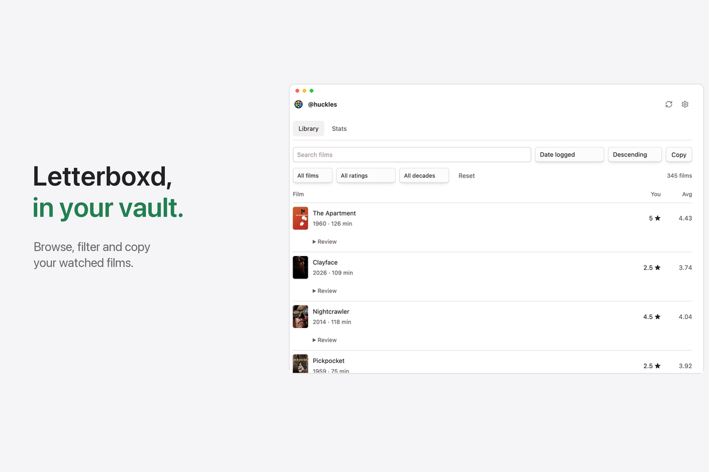
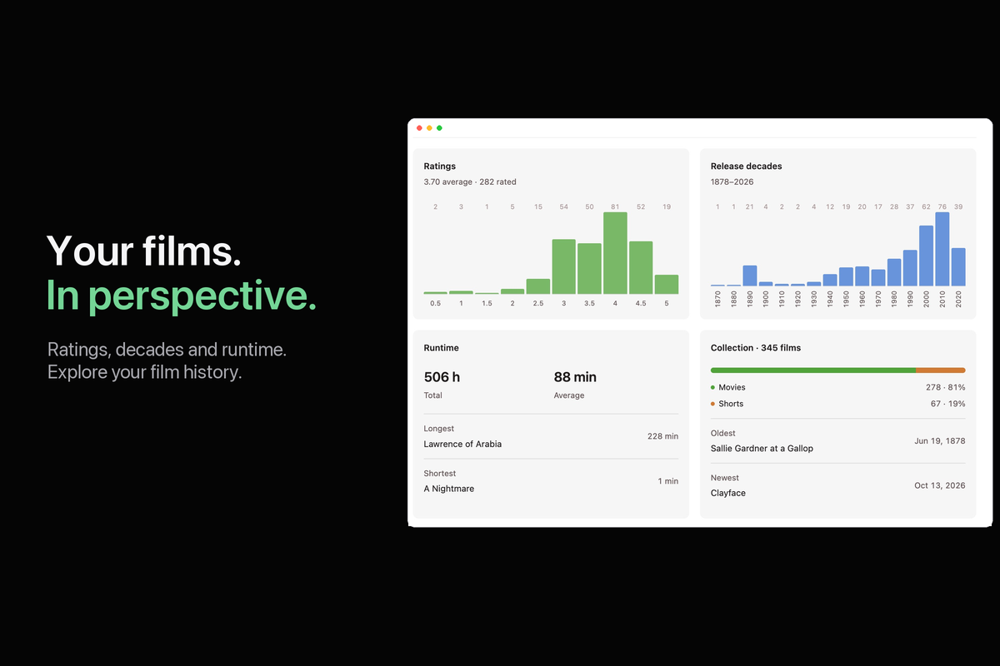

<p align="center"></p>

# Letterboxd Library

Browse your Letterboxd history in Obsidian. Posters, reviews, filters and stats in one local library. Open it beside your writing, or embed it in a note.




## 1 Installation

1. Open **Settings → Community plugins → Browse**.
2. Search for **Letterboxd Library**, install it and enable it.
3. Requires Obsidian **1.7.2 or later** on desktop, iOS or Android.

For manual installation, download `main.js`, `manifest.json` and `styles.css` from the [latest release](https://github.com/jasperdevs/obsidian-letterboxd-library/releases/latest). Put them in `.obsidian/plugins/letterboxd-library/`, then enable the plugin.

## 2 Getting started

1. Open **Settings → Letterboxd Library** and enter your username.
2. Import your original Letterboxd export ZIP to include your complete watched list, ratings and text reviews. You can also import `watched.csv` or refresh a public profile.
3. Click the film icon in the ribbon, or run **Letterboxd Library: Open library**. On desktop, the library opens in the right sidebar and leaves your note in writing mode. On mobile, it opens in a main-workspace tab.
4. Use **Open library note** if you prefer a note. Its location is configurable.

A public Letterboxd profile or a Letterboxd export is needed to populate a library. No password or API key is requested.

## 3 Security and quality

Unit, browser-DOM integration and clean-build tests run in [GitHub Actions](https://github.com/jasperdevs/obsidian-letterboxd-library/actions). They cover imports, account isolation, review rendering, export options, clipboard output and editor interaction.

Release files have GitHub artifact attestations. The readable sources are bundled with esbuild without minification. A clean build reproduces the release byte-for-byte. ZIP decompression uses the bundled fflate library; no Node.js or Electron APIs are required.

Review text is rendered as text, never executable HTML. Copy only writes film titles and years to the clipboard; it never reads clipboard contents. See section 11 for network and data disclosures.

## Table of contents

- [4 Documentation](#4-documentation)
- [5 Keyboard shortcuts](#5-keyboard-shortcuts)
- [6 Synced and local settings](#6-synced-and-local-settings)
- [7 Search and filters](#7-search-and-filters)
- [8 Custom hotkeys](#8-custom-hotkeys)
- [9 Commands](#9-commands)
- [10 Features](#10-features)
- [11 Network and diagnostics disclosure](#11-network-and-diagnostics-disclosure)
- [12 Contact](#12-contact)
- [13 Questions or issues](#13-questions-or-issues)
- [14 License](#14-license)

## 4 Documentation

### Library panel and note embed

The desktop side panel works while you write in Live Preview or Source mode. The mobile library opens in a separate tab. The note embed renders in Reading view and Live Preview when the cursor is outside its code block. Source mode displays Markdown source.

Put this block in any note:

````markdown
```letterboxd-library
```
````

### Pagination

The library shows **50 films per page** by default. Use **Previous**, **Next** or the page selector to move through results. Choose **25**, **50**, **100** or **All** in the footer or in settings; the choice is saved. Search, filters and sorting apply to the full library and return you to page one. Copy, export and stats always use the complete library. Navigation is hidden when the results fit on one page.

### Mobile

Install and enable the plugin through Community plugins on iOS or Android. Import your export ZIP or CSV using the system file picker, or enter a public username and refresh. The library opens in the main workspace so it can use the full screen. Controls wrap for small screens, and charts stack vertically. CSV export saves a file in your vault on every platform.

### Reviews and details

Film rows show the title, release year/runtime, your rating and the Letterboxd average. Dates and text reviews stay inside collapsed **Review** or **Details** sections. Review history is retained for films you have reviewed more than once. Extra ratings and external links are not repeated inside the review text.

Import the complete ZIP to include older reviews. Live refresh can add reviews available in the recent RSS feed; that feed is not a complete review archive. Failed requests preserve saved history.

### Copy and export

**Copy → Both / Movies / Shorts** copies plain `Title (Year)`, one film per line. It never includes reviews, ratings or extra metadata. Search and filters do not change these complete copy categories.

**Refresh before copying** is on by default. If Letterboxd blocks the request, Copy uses the saved library and says so. Disable the setting to copy immediately.

**Export CSV** offers independent switches for **Include ratings** and **Include text reviews**. Reviews are off by default. If selected, all stored reviews are included; review ratings follow the ratings switch. The complete saved library is exported to the vault, even offline. Existing files are never overwritten.

## 5 Keyboard shortcuts

Use **Tab** and **Shift+Tab** to move between controls. Native disclosure controls open with **Enter** or **Space**. Search and filter controls work with the keyboard. Global Obsidian shortcuts remain available while using the embedded library.

## 6 Synced and local settings

The username, settings, film metadata and imported review history are stored in the plugin's `data.json`. If your vault sync service synchronizes plugin data, that service may also synchronize this file. The plugin does not provide its own cloud sync.

Switching usernames hides the previous account's library until the new account is imported or refreshed. A ZIP import selects the username recorded in that export. No account history is bundled with the plugin.

## 7 Search and filters

Search by title or release year. Combine movie/short, rating and release-decade filters. Sort by logged date, title, release date, runtime, your rating or the community average, in either direction. Missing values stay at the end.

**Reset** clears filters and restores newest-logged-first order. Known log dates take precedence over partial ordering from public pages. Older log dates unavailable from Letterboxd are left missing; importing the full export fills recorded dates.

## 8 Custom hotkeys

Assign shortcuts under **Settings → Hotkeys** by searching for **Letterboxd Library**. The plugin does not override your existing hotkeys.

## 9 Commands

| Command | Action |
| --- | --- |
| Open library | Open the right sidebar on desktop or a library tab on mobile. |
| Open library note | Open or create the configured note. |
| Refresh library | Read the public watched list and recent feed. |
| Import export | Choose a Letterboxd export ZIP or watched CSV. |
| Export library as CSV | Choose whether to include reviews and ratings, then save the full library. |

## 10 Features

- **Library:** small lazy-loaded posters, linked titles, rating columns and native controls.
- **Reviews:** collapsed text review history, with dates inside details.
- **Stats:** clickable rating and release-decade charts, runtime, format breakdown, oldest/newest and longest/shortest films.
- **Import:** watched films, ratings, diary entry dates and text reviews from a Letterboxd ZIP. Watchlists, deleted entries and private profile fields are not saved.
- **Copy:** title and year only, for movies, shorts or both.
- **Export:** a complete CSV with optional ratings and review text.
- **Appearance:** Obsidian fonts and theme colors, light/dark support, optional posters.

Stats count unique watched films. Runtime adds known film lengths once, without counting rewatches. Shorts are 40 minutes or less. Unavailable runtimes remain unclassified; they are included in Copy → Both. Release-date comparisons use the full date when available; partial dates remain identified.

## 11 Network and diagnostics disclosure

- **letterboxd.com:** public watched pages, the recent RSS feed and film metadata. Refresh uses the complete watched list; RSS alone is never treated as the full library.
- **boxd.it:** film and review links supplied in exports, resolving to Letterboxd.
- **a.ltrbxd.com / s.ltrbxd.com:** optional poster thumbnails, requested only when displayed. Images are requested without a referrer.

No telemetry, analytics, advertisements, server-side processing or background polling. Requests occur during refresh/import or when you use refresh-before-copy. Cached film details and community averages are checked again after seven days.

Imported reviews are stored locally. They are not sent to Letterboxd. Import reads only the ZIP/CSV you choose; export creates a CSV inside the vault. Letterboxd can block automated requests, so ZIP import and cached copying remain available.

## 12 Contact

Maintained by [jasperdevs](https://github.com/jasperdevs).

## 13 Questions or issues

[Open an issue](https://github.com/jasperdevs/obsidian-letterboxd-library/issues) with your Obsidian version, operating system and steps to reproduce the problem. Do not attach account exports or private reviews unless you intend to share them publicly.

For development, run `npm ci` and `npm run check`. `npm run build` bundles `main.js` from `src/plugin.cjs` and `src/inflate.mjs`. Set `LETTERBOXD_EXPORT` to a local ZIP path to run additional export checks. jsdom is a development-only test dependency.

## 14 License

[MIT](LICENSE). Film posters belong to their respective rights holders; see [third-party notices](THIRD_PARTY_NOTICES.md). The plugin's film-reel mark is an original ImageGen-created asset. Letterboxd Library is independent of Letterboxd and Obsidian.
